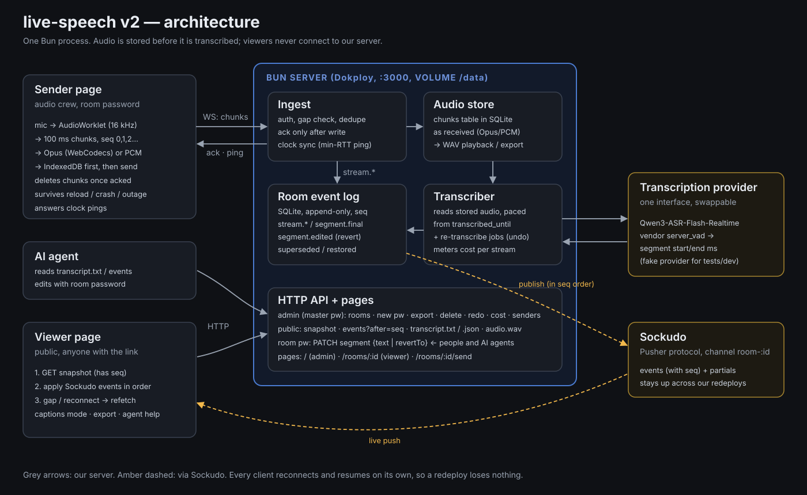

# live-speech

Live captions for local tech talks. It is built for Thai speech mixed with English technical terms.

The audio crew opens a sender page that records from the microphone. The server stores every 100 ms chunk, transcribes it live with one realtime ASR model, and pushes transcript changes to a public viewer page. The server keeps the full recording, so any stretch can be re-transcribed later. Transcript edits are append-only, so a bad edit can always be undone.



The spec is [issue #2](https://github.com/dtinth/live-speech/issues/2). Rewritten from scratch in 2026; the 2024 version is on `main`.

## Running locally

Needs [Bun](https://bun.sh) (the version is pinned in `mise.toml`).

```sh
bun install
cp .env.example .env   # then set MASTER_PASSWORD
bun run dev
```

Open http://localhost:3000, sign in with the master password, and create a room.

Without `DASHSCOPE_API_KEY`, a fake transcriber stands in for the real one. It turns each 100 ms of non-silent audio into a placeholder word.

Without Sockudo settings, viewers poll the server instead of getting pushes. To run Sockudo locally:

```sh
docker run -d --name live-speech-sockudo -p 127.0.0.1:6001:6001 \
  -e SOCKUDO_DEFAULT_APP_ID=live-speech \
  -e SOCKUDO_DEFAULT_APP_KEY=live-speech-key \
  -e SOCKUDO_DEFAULT_APP_SECRET=live-speech-secret \
  ghcr.io/sockudo/sockudo:5.2.0
```

## Tests

```sh
bun test
bun run typecheck
```

The tests need no network or credentials.

## Deploying (Dokploy)

Build from the `Dockerfile`. The app listens on port 3000. Mount a persistent volume at `/data`: the SQLite database there holds all audio and transcripts.

Set the environment variables listed in `.env.example`. At minimum, set:

- `MASTER_PASSWORD`
- `DASHSCOPE_API_KEY`
- the `SOCKUDO_*` settings. Set `SOCKUDO_WS_URL` to the public `wss://` URL that browsers connect to.

Run one replica, and keep Swarm's default `stop-first` update order: two servers must never share the database. Redeploys are safe. Senders keep recording into IndexedDB and upload the backlog once the server is back. Viewers re-sync from their last sequence number. Any audio that was stored but not yet transcribed is transcribed after startup.

## Using it

- **Admin** (`/`, master password): create rooms and copy the invite for the audio crew. From here you can also:
  - see whether a sender is live;
  - see what transcription has cost;
  - re-transcribe a stream (with undo);
  - export a room as a SQLite file (audio, transcript and history), then delete it.
- **Sender** (`/rooms/:id/send`, room password): press Start. Keep the tab open. Closing it is safe: anything not yet uploaded is sent when the page is opened again.
- **Viewer** (`/rooms/:id`, public): the live transcript, a captions mode, and text export. The viewer also explains how to point an AI agent at the transcript (`transcript.txt`, `events?after=`) and how to let it fix segments using the room password.

## Cost

Transcription cost is metered from the audio fed to the model. Audio re-fed after a vendor error or by a re-transcription counts again. The price is `QWEN_PRICE_PER_HOUR_USD`. It defaults to $0.324/h, which is $0.00009/s, Model Studio's international list price for `qwen3-asr-flash-realtime`. Free quota is not taken into account.
